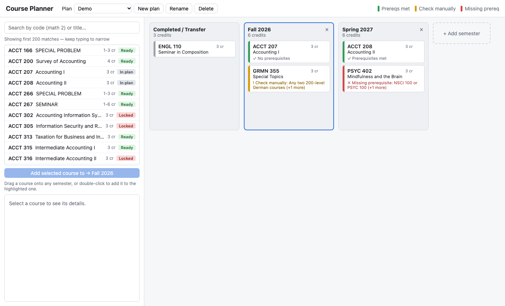

# Course Planner

A web app and REST API for planning courses semester by semester. The backend
loads a catalog of about 7,400 courses, turns their plain-English
prerequisites into rules it can check, and validates every plan change. The
browser front end shows each course's status as you build the plan.

**Stack:** Java 21+, Spring Boot 3.5, Spring Data JPA, H2 database, Maven,
JUnit 5, JaCoCo. Front end is plain HTML/CSS/JavaScript.



## Running

You need Java 21 or newer (`java -version`). Maven doesn't need to be
installed; the included wrapper (`./mvnw`) downloads it the first time.

```sh
./mvnw spring-boot:run
```

Then open **http://localhost:8080**.

Plans are saved in `data/planner.mv.db`, so they survive restarts. To browse
the tables, open http://localhost:8080/h2-console (JDBC URL
`jdbc:h2:file:./data/planner`, user `sa`, no password).

To build a standalone jar instead:

```sh
./mvnw package
java -jar target/course-planner-0.1.0.jar
```

## Testing

```sh
./mvnw test
```

This runs 60 tests and writes a coverage report to
`target/site/jacoco/index.html`.

| Coverage (JaCoCo) | |
|---|---|
| Lines | **99.5%** (402 / 404) |
| Branches | **94.5%** (208 / 220) |

The only uncovered lines are `main()`, which starts the server. The
JavaScript front end isn't included in these numbers.

| Test class | What it covers |
|---|---|
| `PrereqParserTest` | every prerequisite pattern in the table below |
| `PlanTest` | prerequisite checks, same-semester rules, terms, duplicates, badges, credit totals, term names |
| `CatalogTest` | loading, lookup, search, "prerequisite for" index, credits and terms |
| `RealCatalogTest` | the real `catalog.json` still loads 7,436 courses and parser coverage doesn't drop |
| `PlanApiTest` | the plan endpoints end to end (controller → service → database), including 404 and 400 errors |
| `CourseApiTest` | search, badges, course details, and serving the web page |

Unit tests use a small 19-course test catalog (`src/test/resources/test-catalog.json`),
so they're fast and don't break if the real catalog changes. API tests run
against an in-memory database.

## Using the app

- **Search** on the left by course code (`math 2`, `chem103`) or title words.
  Click a course for its details; course codes under "Prerequisite for" are links.
- **Add courses** by dragging them onto a semester, or by double-clicking,
  which adds to the column outlined in blue.
- **Move** a course by dragging its card to another column. Hover a card and
  click **×** to remove it.
- **Semesters:** **+ Add semester** suggests the next term. Double-click a
  title to rename it; **×** deletes it.
- **Plans:** create, switch, rename and delete plans from the top bar.

**Card colors**

| Stripe | Meaning |
|---|---|
| Green | Prerequisites are done in Completed or an earlier semester |
| Yellow | Check yourself: a prerequisite the app can't verify, or the course isn't usually offered that term |
| Red | A required prerequisite is missing |
| Gray | In the Completed column |

**Search badges**

| Badge | Meaning |
|---|---|
| Ready | Courses already in your plan cover its prerequisites |
| Check | It has prerequisites that can't be checked automatically |
| Locked | It needs a course that isn't in your plan yet |
| In plan | It's already in your plan |

## API

All responses are JSON. Every request that changes a plan returns the whole
updated plan with each course re-checked, so the client never computes
statuses itself.

| Method | Path | Does |
|---|---|---|
| `GET` | `/api/courses?q=&limit=&planId=` | Search the catalog. With `planId`, each result gets an `availability` badge and `hint`. `limit` is capped at 300. |
| `GET` | `/api/courses/{courseId}` | Details, parsed prerequisites, and which courses it unlocks |
| `GET` | `/api/plans` | List plans, most recently changed first |
| `POST` | `/api/plans` | Create a plan (optional body `{"name": "..."}`). Returns `201` with a `Location` header. |
| `GET` | `/api/plans/{planId}` | A plan with every course's status and messages |
| `PATCH` | `/api/plans/{planId}` | Rename: `{"name": "..."}` |
| `DELETE` | `/api/plans/{planId}` | Delete. Returns `204`. |
| `POST` | `/api/plans/{planId}/semesters` | Add a semester (optional name; defaults to the next term) |
| `PATCH` | `/api/plans/{planId}/semesters/{semesterId}` | Rename a semester |
| `DELETE` | `/api/plans/{planId}/semesters/{semesterId}` | Delete a semester |
| `PUT` | `/api/plans/{planId}/semesters/{semesterId}/courses/{courseId}` | Put a course in a semester, moving it if it's elsewhere in the plan |
| `DELETE` | `/api/plans/{planId}/semesters/{semesterId}/courses/{courseId}` | Remove a course from a semester |
| `PUT` | `/api/plans/{planId}/completed/{courseId}` | Mark a course completed |
| `DELETE` | `/api/plans/{planId}/completed/{courseId}` | Unmark it |

Course ids can be written with or without the space and in any case:
`ACCT%20207`, `acct207`.

**Example:**

```sh
curl -X POST localhost:8080/api/plans -H 'Content-Type: application/json' -d '{"name":"Demo"}'
curl -X PUT  localhost:8080/api/plans/1/semesters/1/courses/ACCT%20208
```
```json
{"id":1,"name":"Demo","completedCredits":"0","completed":[],
 "semesters":[{"id":1,"name":"Fall 2026","credits":"3","courses":[
   {"id":"ACCT 208","name":"Accounting II","credits":"3","status":"ERROR",
    "messages":["Missing prerequisite: ACCT 207"]}]}], "updatedAt":"..."}
```

**Errors** use the standard problem-detail format (RFC 9457):

```json
{"type":"about:blank","title":"Not found","status":404,"detail":"Plan 42 not found","instance":"/api/plans/42"}
```

Unknown plans, semesters or courses return `404`. Invalid input, such as a
blank name, malformed JSON or a non-numeric id, returns `400`.

## How it works

```
Browser (static/app.js)
   │  HTTP + JSON
   ▼
api/        CourseController, PlanController   routes, request validation
            ApiExceptionHandler                errors → problem-detail JSON
   ▼
service/    CourseService, PlanService         use cases, one transaction each
   ▼                    ▼
domain/                 persistence/
  Catalog, Course         PlanEntity, SemesterEntity, PlanRepository
  PrereqParser, Prereq    (Spring Data JPA → H2)
  Plan (the checks)
```

- **The catalog** (`catalog.json`) is read-only reference data, so it's
  loaded into memory once at startup as a singleton bean (`CatalogConfig`).
  Lookups and searches don't touch the database.
- **Plans** are stored in the database. On each request `PlanService` loads
  the plan, converts it to the domain `Plan`, applies the change, saves it,
  and runs `Plan.check` on every course to build the response.
- **The domain layer has no Spring code**, so the prerequisite logic is
  unit-tested without starting a server.
- **DTOs** (`dto/Dtos.java`) are separate from the database entities, so the
  API's JSON and the table layout can change independently.

### Database tables

```
plans(id, name, updated_at)
plan_completed(plan_id, position, course_id)
semesters(id, plan_id, position, name)
semester_courses(semester_id, position, course_id)
```

`position` columns keep semesters and courses in order. A course appears at
most once per plan, so placing it somewhere moves it.

### Reading prerequisites

Prerequisites in the catalog are plain English, so `PrereqParser` turns them
into rules. Each course gets a list of **groups**. Every group must be
satisfied, and any one course in a group satisfies it.

| Text | Read as |
|---|---|
| `ACCT 207.` | ACCT 207 |
| `ECON 101 and ECON 103` | ECON 101 **and** ECON 103 |
| `CHEM322 or CHEM332` | CHEM 322 **or** CHEM 332 |
| `CHEM103/104` | CHEM 103 **or** CHEM 104 |
| `MATH 241, 242, or 243` | any one of the three |
| `PSYC209 or approved substitutes (STAT200, MATH202)` | any one of PSYC 209, STAT 200, MATH 202 |
| `C- or better in NSCI100` | NSCI 100 (grade wording is ignored) |
| `MATH 241 or permission of instructor` | MATH 241, but a miss is only a warning |
| `Any two 200-level German courses` | a note to check yourself |

The rules:

- `;`, sentence breaks, `,` and `and` separate requirements, which all apply.
- `or` and `/` separate alternatives. A list ending in `, or X` means any one
  of the items.
- A bare number like `104` in `CHEM 103/104` reuses the last department code.
- Only codes that exist in the catalog count. Anything else becomes a note.
- If the text mentions "concurrent" or "corequisite", prerequisites taken in
  the same semester count.

Of the 2,311 courses with prerequisites, 2,089 (about 90%) have at least one
requirement checked automatically. Most of the rest aren't course codes at
all, such as class standing, instructor permission, placement exams, or "any
two 200-level courses", and are shown as notes.

**Limitations:** grade requirements aren't enforced, and nested logic like
"(A and B) or C" is simplified. The original prerequisite text is always shown.

### Checking a course

For a course in semester *N*, `Plan.check` looks at the courses in Completed
and in semesters before *N* (plus semester *N* itself if concurrent
enrollment is allowed), then reports:

- **Error:** a required group isn't satisfied.
- **Warning:** a group with a non-course alternative isn't satisfied, there's
  a note to check, or the semester's term (the first word of its name: Fall,
  Winter, Spring or Summer) isn't one the course is offered in.

## Project layout

```
pom.xml                         Maven build (Spring Boot, JaCoCo)
mvnw, mvnw.cmd, .mvn/           Maven Wrapper
src/main/java/planner/
  CoursePlannerApplication.java entry point
  CatalogConfig.java            loads catalog.json at startup
  api/                          REST controllers and error handling
  service/                      plan and course use cases
  domain/                       catalog, prerequisite parser, plan checks
  persistence/                  JPA entities and repository
  dto/                          request and response shapes
src/main/resources/
  application.properties        database and catalog settings
  catalog.json                  course data
  static/                       web front end (index.html, app.js, styles.css)
src/test/                       unit and API tests, test catalog
docs/screenshot.png             screenshot used above
```

## History

The project started as a Swing desktop app with a hand-written JSON parser,
then moved to this Spring Boot backend and web front end
([pull request #1](https://github.com/KerryFerguson04/course-planner/pull/1)).
The desktop version is still in the history at commit `19bbe0f`.
